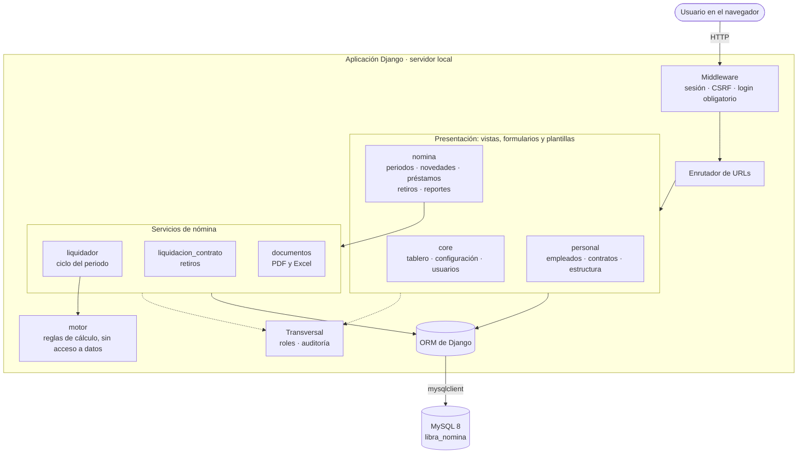
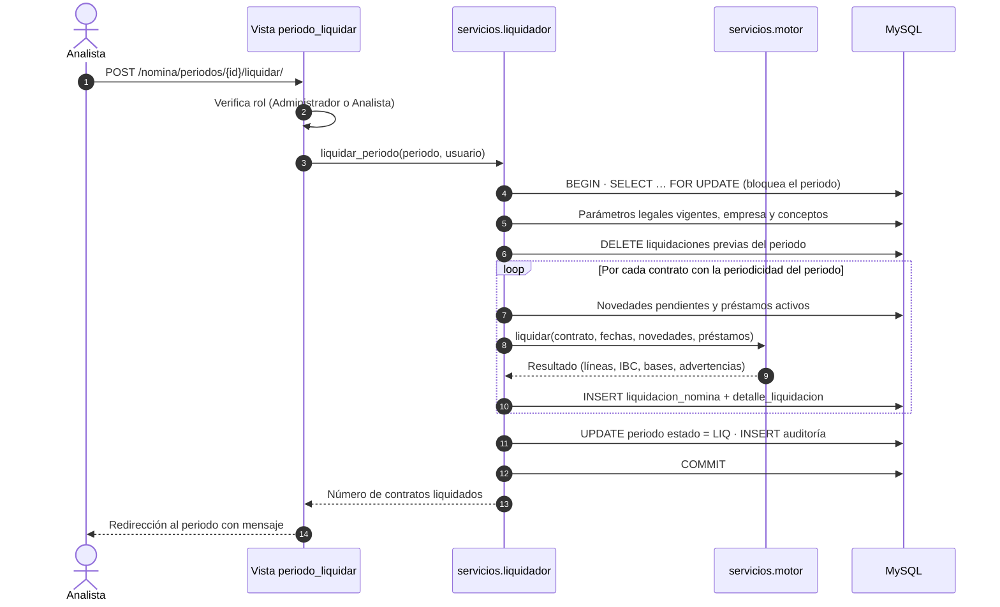
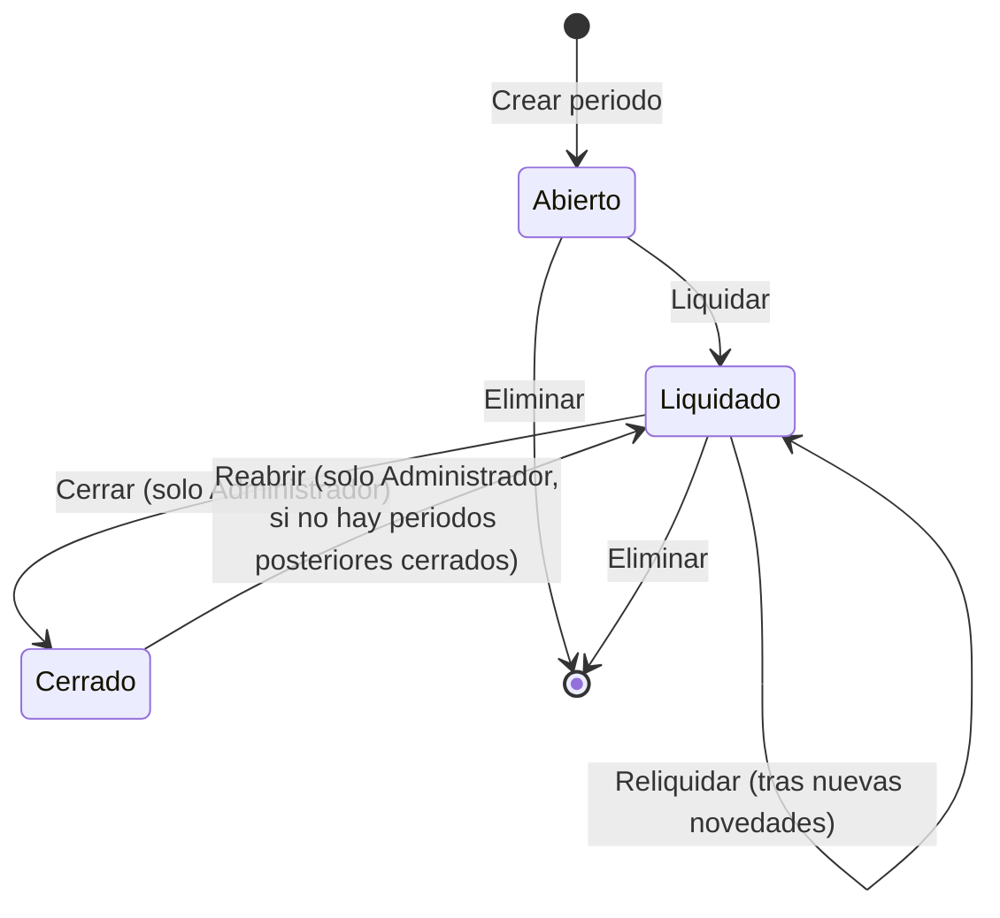
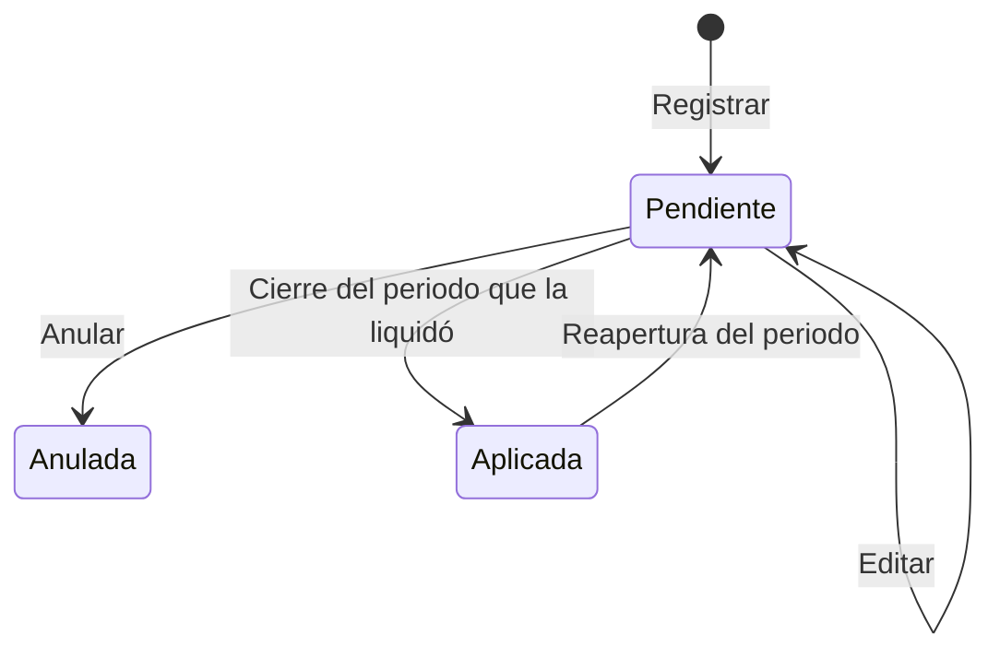

# 1. Arquitectura del software

**Libra — Sistema de Nómina** es una aplicación web monolítica que se ejecuta en el equipo local. Liquida nómina quincenal y mensual bajo la legislación laboral colombiana y gestiona todo el ciclo: personal, novedades, liquidación, cierre, pagos, reportes y retiros.

## 1.1 Tecnologías

| Capa | Tecnología | Motivo de la elección |
|---|---|---|
| Lenguaje | Python 3.11+ | Aritmética decimal exacta (`decimal.Decimal`), indispensable para dinero. |
| Framework web | Django 5.2 LTS | ORM, migraciones, autenticación, sesiones y protección CSRF incluidos. Soporte extendido hasta abril de 2028. |
| Base de datos | MySQL 8.0 o superior | Motor relacional transaccional (InnoDB) con integridad referencial. |
| Conector | `mysqlclient` | Controlador nativo recomendado por Django para MySQL. |
| Interfaz | Plantillas Django + CSS propio | Sin frameworks de UI ni dependencias de internet. El sistema funciona sin conexión. |
| Documentos | ReportLab (PDF), openpyxl (Excel) | Desprendibles, liquidaciones de retiro, sábana de nómina y reportes. |

## 1.2 Vista de componentes



## 1.3 Capas

El código está organizado en tres capas con responsabilidades separadas:

| Capa | Ubicación | Responsabilidad | Accede a la BD |
|---|---|---|---|
| Presentación | `views.py`, `forms.py`, `templates/`, `static/` | Recibir solicitudes, validar formularios, mostrar resultados. | Sí, consultas de lectura simples |
| Servicios | `apps/nomina/servicios/` | Orquestar procesos de negocio en transacciones: liquidar, cerrar, reabrir, retirar. | Sí |
| Dominio de cálculo | `apps/nomina/servicios/motor.py` | Reglas legales puras. Recibe objetos y devuelve resultados. | **No** |
| Datos | `models.py` + migraciones | Esquema, restricciones e integridad. | — |

El **motor de cálculo no consulta la base de datos**. Esto permite probarlo con datos en memoria (ver `apps/nomina/tests.py`) y deja todas las reglas de liquidación en un solo archivo, en el orden en que se aplican.

## 1.4 Estructura de carpetas

```
nomina-corp/
├── manage.py                  Punto de entrada de comandos Django
├── requirements.txt           Dependencias de Python
├── .env.ejemplo               Plantilla de configuración local
├── config/                    Configuración del proyecto (settings, urls, wsgi)
├── apps/
│   ├── core/                  Empresa, parámetros legales, entidades, usuarios, auditoría
│   │   ├── management/commands/
│   │   │   ├── inicializar_catalogos.py   Conceptos, entidades, parámetros, roles
│   │   │   ├── cargar_demo.py             Empresa ficticia con historia
│   │   │   └── documentar_bd.py           Genera diagrama ER y diccionario
│   │   ├── roles.py           Definición de roles y decorador de permisos
│   │   ├── auditoria.py       Registro de acciones
│   │   └── templatetags/libra.py  Formatos de pesos, porcentajes y estados
│   ├── personal/              Centros de costo, áreas, cargos, empleados, contratos
│   └── nomina/                Conceptos, periodos, novedades, préstamos, liquidaciones
│       ├── catalogo.py        Catálogo base de conceptos y entidades
│       ├── servicios/
│       │   ├── motor.py               Reglas de cálculo (sin base de datos)
│       │   ├── liquidador.py          Liquidar, cerrar y reabrir periodos
│       │   ├── liquidacion_contrato.py Liquidación definitiva por retiro
│       │   └── documentos.py          Desprendibles PDF y reportes Excel
│       └── tests.py           Pruebas automatizadas
├── templates/                 Plantillas HTML
├── static/                    CSS e imagen de marca
└── docs/                      Esta documentación
```

## 1.5 Flujo de liquidación de un periodo



Toda la liquidación ocurre en **una sola transacción**: si un contrato falla, no queda ninguna liquidación parcial.

## 1.6 Ciclo de vida del periodo



| Estado | Código | Qué se puede hacer |
|---|---|---|
| Abierto | `BOR` | Registrar novedades, liquidar, eliminar el periodo. |
| Liquidado | `LIQ` | Revisar, descargar desprendibles y sábana, reliquidar, cerrar. |
| Cerrado | `CER` | Solo consulta. Las novedades quedan **aplicadas** y los saldos de préstamos **descontados**. |

Al **cerrar** el periodo:

1. Las novedades usadas pasan a estado *Aplicada* y quedan vinculadas al periodo. Si una ausencia por días continúa después de la fecha final, sigue *Pendiente* para que el siguiente periodo liquide los días restantes.
2. Las cuotas descontadas se restan del saldo de cada préstamo. Si el saldo llega a cero, el préstamo pasa a *Pagado*.

**Reabrir** revierte exactamente esos dos efectos.

## 1.7 Ciclo de vida de la novedad



## 1.8 Seguridad

| Mecanismo | Implementación |
|---|---|
| Autenticación | Usuario y contraseña (hash PBKDF2 de Django). Sesión de 8 horas. |
| Acceso | `LoginObligatorioMiddleware` exige sesión en todas las páginas excepto el ingreso. |
| Autorización | Tres roles (grupos de Django) verificados con el decorador `requiere_rol`. |
| Integridad de formularios | Token CSRF en todos los formularios. Las acciones que modifican datos solo aceptan POST. |
| Concurrencia | `SELECT … FOR UPDATE` sobre el periodo al liquidar, cerrar o reabrir. |
| Trazabilidad | Tabla `auditoria` con usuario, fecha, acción y registro afectado. |
| Secretos | Clave secreta y credenciales de la base de datos en `.env`, fuera del código. |

### Roles

| Acción | Administrador | Analista de nómina | Consulta |
|---|:---:|:---:|:---:|
| Consultar información | ✔ | ✔ | ✔ |
| Empleados, contratos, novedades, préstamos | ✔ | ✔ | |
| Crear y liquidar periodos | ✔ | ✔ | |
| Elaborar liquidaciones de retiro (borrador) | ✔ | ✔ | |
| Cerrar y reabrir periodos | ✔ | | |
| Aprobar liquidaciones de retiro | ✔ | | |
| Parámetros, entidades, estructura, empresa | ✔ | | |
| Usuarios y auditoría | ✔ | | |

## 1.9 Decisiones de diseño

| Decisión | Alternativa descartada | Razón |
|---|---|---|
| Parámetros legales con **fecha de vigencia** | Una tabla por año | La reforma laboral cambia valores a mitad de año (recargo dominical en julio, jornada en julio). |
| Liquidación como **foto inmutable** (`detalle_liquidacion` guarda base, tasa y valor) | Recalcular al consultar | Un cambio posterior de parámetros o salario no altera nóminas ya pagadas. |
| **Mes comercial de 30 días** | Días calendario | Práctica laboral colombiana: toda quincena vale 15 días y todo mes 30. |
| Interfaz **sin JavaScript de terceros** | Frameworks SPA | Funciona sin internet, es fácil de mantener y carga rápido. |
| Retención en la fuente sobre el **equivalente mensual** en quincenas | Retener solo en la segunda quincena | Distribuye la retención de forma pareja y no depende del orden de liquidación. |
