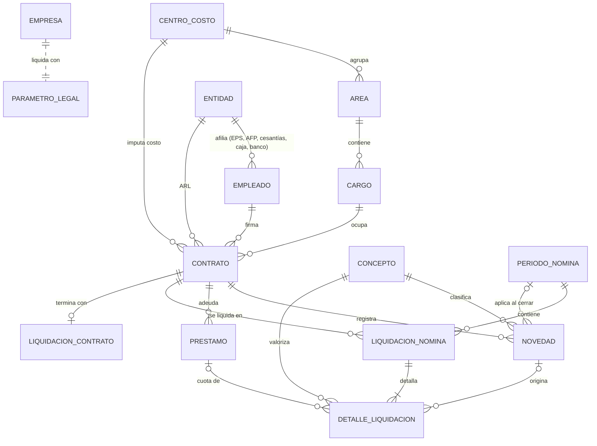
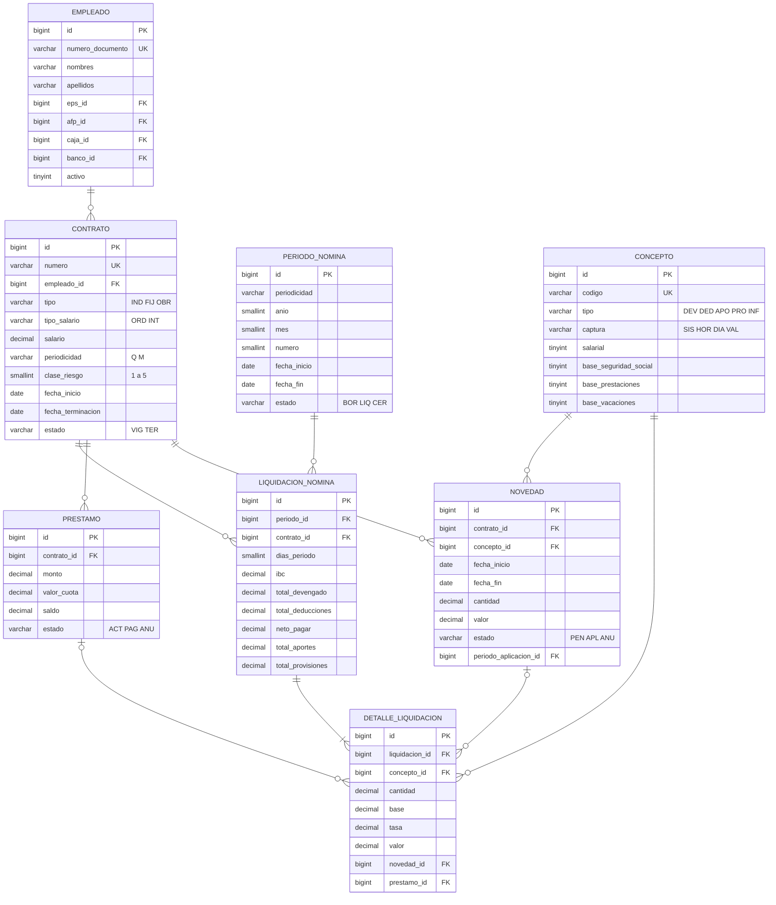

# 2. Base de datos

| Elemento | Valor |
|---|---|
| Motor | MySQL 8.0 o superior (probado con 8.4 LTS) |
| Base de datos | `libra_nomina` |
| Juego de caracteres | `utf8mb4` / `utf8mb4_unicode_ci` |
| Almacenamiento | InnoDB (transacciones y llaves foráneas) |
| Creación del esquema | Migraciones de Django (`python manage.py migrate`) |
| Tablas propias | 16 |

Documentos complementarios, generados automáticamente desde el código:

- [Diagrama entidad-relación completo por módulo](base-de-datos/diagrama-er.md)
- [Diccionario de datos: tablas, columnas, tipos y restricciones](base-de-datos/diccionario.md)
- [Script DDL del esquema (`CREATE TABLE`)](base-de-datos/esquema.sql)

> Si modifica los modelos, regenere el diagrama y el diccionario con `python manage.py documentar_bd`.

## 2.1 Modelo conceptual

El modelo se organiza en tres grupos:

- **Configuración**: empresa, parámetros legales vigentes por fecha y entidades.
- **Personal**: la estructura organizacional y los vínculos laborales.
- **Nómina**: los hechos del periodo, sus resultados y los retiros.



> La relación entre `EMPRESA` y `PARAMETRO_LEGAL` es lógica, no una llave foránea: el sistema maneja una sola empresa y toma el parámetro vigente según la fecha del periodo.

## 2.2 Modelo físico simplificado

Columnas principales de las tablas centrales del proceso de nómina. El detalle completo está en el [diccionario](base-de-datos/diccionario.md).



## 2.3 Descripción de las tablas

| Tabla | Propósito | Cardinalidad típica |
|---|---|---|
| `empresa` | Datos del empleador y si aplica la exoneración de aportes del art. 114-1 E.T. | 1 registro |
| `parametro_legal` | SMMLV, auxilio de transporte, UVT, horas mensuales, recargos y porcentajes de aportes, con fecha de vigencia. | 1 a 3 por año |
| `entidad` | EPS, fondos de pensiones y cesantías, cajas de compensación, ARL y bancos. | Decenas |
| `auditoria` | Bitácora de acciones de los usuarios. | Crece con el uso |
| `centro_costo`, `area`, `cargo` | Estructura organizacional para clasificar el costo. | Decenas |
| `empleado` | Persona: identificación, contacto, cuenta bancaria y afiliaciones. | 1 por trabajador |
| `contrato` | Vínculo laboral. Un empleado puede tener varios en el tiempo, pero solo uno vigente. | 1 o más por empleado |
| `concepto` | Catálogo de devengados, deducciones, aportes y provisiones, con sus banderas de base. | 37 |
| `periodo_nomina` | Quincena o mes a liquidar. | 36 por año (24 Q + 12 M) |
| `novedad` | Horas extra, recargos, ausencias, pagos y descuentos. | Varias por contrato y periodo |
| `prestamo` | Créditos de la empresa y libranzas, con saldo vivo. | Pocos |
| `liquidacion_nomina` | Encabezado del resultado por contrato y periodo, con totales. | Contratos × periodos |
| `detalle_liquidacion` | Línea por concepto liquidado: cantidad, base, tasa y valor. | ~12 por liquidación |
| `liquidacion_contrato` | Liquidación definitiva al terminar un contrato. | 1 por contrato terminado |

## 2.4 Reglas de integridad

**Llaves únicas**

| Tabla | Única |
|---|---|
| `empleado` | `numero_documento` |
| `contrato` | `numero` |
| `concepto` | `codigo` |
| `parametro_legal` | `vigente_desde` |
| `entidad` | (`tipo`, `nombre`) |
| `periodo_nomina` | (`periodicidad`, `anio`, `mes`, `numero`) |
| `liquidacion_nomina` | (`periodo_id`, `contrato_id`): un contrato se liquida una sola vez por periodo |
| `liquidacion_contrato` | `contrato_id`: una liquidación definitiva por contrato |

**Comportamiento al eliminar** (lo aplica Django antes de ejecutar el `DELETE`):

| Relación | Regla | Efecto |
|---|---|---|
| Catálogos → registros (empleado, contrato, concepto, entidad, cargo…) | `PROTECT` | No se puede borrar un catálogo en uso; se debe inactivar. |
| `periodo_nomina` → `liquidacion_nomina` → `detalle_liquidacion` | `CASCADE` | Eliminar o reliquidar un periodo borra sus resultados. |
| `novedad` / `prestamo` → `detalle_liquidacion` | `SET NULL` | El detalle histórico se conserva aunque cambie el origen. |
| `auth_user` → auditoría y periodos | `SET NULL` | La traza se conserva aunque se elimine el usuario. |

**Reglas de negocio validadas por la aplicación**

- El salario no puede ser inferior al SMMLV vigente; el salario integral debe ser de al menos 13 SMMLV.
- Los contratos a término fijo requieren fecha de finalización posterior al inicio.
- Las novedades por horas requieren cantidad; las de días, rango de fechas; las de valor, un valor positivo.
- Un periodo cerrado no se puede reliquidar, editar ni eliminar.
- Solo se pueden editar o anular novedades *Pendientes*.

## 2.5 Convenciones

| Convención | Ejemplo |
|---|---|
| Nombres de tablas en español, singular y `snake_case` | `periodo_nomina` |
| Llave primaria `id BIGINT AUTO_INCREMENT` | |
| Llaves foráneas con sufijo `_id` | `contrato_id` |
| Dinero en `DECIMAL(14,2)`, pesos colombianos | `1750905.00` |
| Porcentajes como fracción en `DECIMAL(6,4)` | `0.0850` = 8,5 % |
| Estados como códigos de 3 letras | `BOR`, `LIQ`, `CER` |
| Fechas y horas en zona `America/Bogota` (se almacenan en UTC) | |

## 2.6 Consultas de ejemplo

Costo de nómina por centro de costo en un mes:

```sql
SELECT cc.nombre                                        AS centro_costo,
       COUNT(DISTINCT ln.contrato_id)                   AS empleados,
       SUM(ln.total_devengado)                          AS devengado,
       SUM(ln.total_aportes)                            AS aportes,
       SUM(ln.total_provisiones)                        AS provisiones,
       SUM(ln.total_devengado + ln.total_aportes + ln.total_provisiones) AS costo_total
FROM liquidacion_nomina ln
JOIN periodo_nomina p ON p.id = ln.periodo_id
JOIN contrato c       ON c.id = ln.contrato_id
JOIN centro_costo cc  ON cc.id = c.centro_costo_id
WHERE p.anio = 2026 AND p.mes = 10 AND p.estado = 'CER'
GROUP BY cc.nombre
ORDER BY costo_total DESC;
```

Horas extra pagadas por empleado en el año:

```sql
SELECT e.numero_documento, CONCAT(e.nombres, ' ', e.apellidos) AS empleado,
       co.codigo, SUM(d.cantidad) AS horas, SUM(d.valor) AS valor
FROM detalle_liquidacion d
JOIN concepto co           ON co.id = d.concepto_id
JOIN liquidacion_nomina ln ON ln.id = d.liquidacion_id
JOIN periodo_nomina p      ON p.id = ln.periodo_id
JOIN contrato c            ON c.id = ln.contrato_id
JOIN empleado e            ON e.id = c.empleado_id
WHERE co.captura = 'HOR' AND p.anio = 2026 AND p.estado = 'CER'
GROUP BY e.numero_documento, empleado, co.codigo
ORDER BY empleado, co.codigo;
```

Saldo de préstamos activos:

```sql
SELECT e.apellidos, e.nombres, pr.descripcion, pr.monto, pr.valor_cuota, pr.saldo
FROM prestamo pr
JOIN contrato c ON c.id = pr.contrato_id
JOIN empleado e ON e.id = c.empleado_id
WHERE pr.estado = 'ACT'
ORDER BY pr.saldo DESC;
```

## 2.7 Respaldo y restauración

```bash
# Respaldo completo (estructura + datos)
mysqldump -u libra -p --single-transaction --routines libra_nomina > respaldo_libra_AAAAMMDD.sql

# Restauración en una base vacía
mysql -u libra -p libra_nomina < respaldo_libra_AAAAMMDD.sql
```

Se recomienda respaldar **antes de cerrar cada periodo** y antes de actualizar el software.
