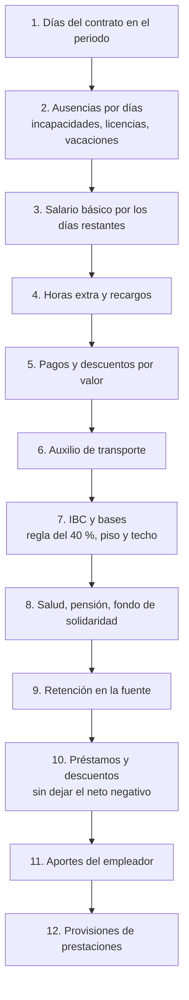

# 3. Reglas de cálculo

Este documento describe **exactamente** lo que hace el motor de cálculo (`apps/nomina/servicios/motor.py`) y la liquidación de retiros (`apps/nomina/servicios/liquidacion_contrato.py`). Cada regla indica su fundamento normativo.

> **Parámetros legales.** Los valores (SMMLV, auxilio de transporte, UVT, horas mensuales, recargos y porcentajes de aportes) **no están escritos en el código**: se leen de la tabla `parametro_legal` según la fecha final del periodo. Verifíquelos y actualícelos cada año en *Configuración → Parámetros legales*.

## 3.1 Parámetros cargados por defecto

| Vigente desde | SMMLV | Aux. transporte | UVT | Horas/mes | Rec. dominical | Norma |
|---|---:|---:|---:|---:|---:|---|
| 01/01/2025 | 1.423.500 | 200.000 | 49.799 | 230 | 75 % | Decreto 1572 de 2024 · Ley 2101 (46 h) |
| 01/07/2025 | 1.423.500 | 200.000 | 49.799 | 230 | 80 % | Ley 2466 de 2025 |
| 15/07/2025 | 1.423.500 | 200.000 | 49.799 | 220 | 80 % | Ley 2101 de 2021 (44 h) |
| 01/01/2026 | 1.750.905 | 249.095 | 52.374 | 220 | 80 % | Decreto salario mínimo 2026 |
| 01/07/2026 | 1.750.905 | 249.095 | 52.374 | 220 | 90 % | Ley 2466 de 2025 |
| 15/07/2026 | 1.750.905 | 249.095 | 52.374 | 210 | 90 % | Ley 2101 de 2021 (42 h) |

Valores fijos en todos los registros: recargo nocturno 35 %, hora extra diurna 25 %, hora extra nocturna 75 %, salud 4 % + 8,5 %, pensión 4 % + 12 %, caja 4 %, ICBF 3 %, SENA 2 %.

**Horas mensuales** = jornada semanal × 5 (42 h × 5 = 210). Es el divisor del valor de la hora ordinaria.

## 3.2 Días liquidados

Se usa el **mes comercial de 30 días** (art. 134 CST y práctica contable):

| Periodo | Días |
|---|---|
| Quincena 1 (del 1 al 15) | 15 |
| Quincena 2 (del 16 al último día del mes) | 15, aunque el mes tenga 28 o 31 días |
| Mes | 30 |

Si el contrato inicia o termina dentro del periodo, se cuentan los días comerciales entre ambas fechas. La función `dias360` trata el día 31 y el último día de febrero como el día 30.

```
días del contrato   = días comerciales del periodo en que el contrato estuvo vigente
días de ausencia    = suma de días de novedades por días dentro del periodo
días de salario     = días del contrato − días de ausencia
```

## 3.3 Orden de cálculo



## 3.4 Devengados

### Salario básico

```
salario diario = salario mensual / 30
SAL            = salario diario × días de salario
```

### Horas extra y recargos

```
valor hora = salario mensual / horas mensuales
valor      = valor hora × factor × horas
```

| Código | Concepto | Factor | Con parámetros de 15/07/2026 |
|---|---|---|---:|
| `RN` | Recargo nocturno (hora ordinaria en horario nocturno) | % nocturno | 0,35 |
| `HED` | Hora extra diurna | 1 + % extra diurna | 1,25 |
| `HEN` | Hora extra nocturna | 1 + % extra nocturna | 1,75 |
| `HDF` | Hora dominical o festiva diurna | 1 + % dominical | 1,90 |
| `HNDF` | Hora dominical o festiva nocturna | 1 + % dominical + % nocturno | 2,25 |
| `HEDDF` | Hora extra diurna dominical o festiva | 1 + % extra diurna + % dominical | 2,15 |
| `HENDF` | Hora extra nocturna dominical o festiva | 1 + % extra nocturna + % dominical | 2,65 |

Fundamento: arts. 168 y 179 CST, Ley 2466 de 2025 (recargo dominical gradual y trabajo nocturno desde las 7:00 p. m.).

El **recargo nocturno** (`RN`) solo paga el recargo, porque la hora ordinaria ya está incluida en el salario. Los demás códigos pagan la hora completa más el recargo.

Con **salario integral** las novedades por horas no se pagan, porque ese salario ya compensa el trabajo extra, nocturno y dominical (art. 132 CST). El sistema deja una advertencia.

### Ausencias por días

| Código | Concepto | Pago por día | Quién asume en la realidad |
|---|---|---|---|
| `INCG` | Incapacidad por enfermedad general | Días 1-2: 100 %. Días 3-90: 66,67 %. Días 91-180: 50 %. **Nunca menos del SMMLV diario.** | Empleador días 1-2; EPS desde el día 3 |
| `INCL` | Incapacidad por accidente de trabajo | 100 % | ARL |
| `LMP` | Licencia de maternidad o paternidad | 100 % | EPS |
| `LREM` | Licencia remunerada (luto, calamidad) | 100 % | Empleador |
| `VACD` | Vacaciones disfrutadas | 100 % por día calendario del rango | Empleador |
| `LNR` | Licencia no remunerada | 0 % | — |
| `SUS` | Suspensión disciplinaria | 0 % | — |

Para la **incapacidad general**, el número de día se cuenta desde el inicio de la incapacidad, no del periodo. Si una incapacidad empezó el 28 de octubre, en noviembre sus días ya son el 4, 5, 6… y se pagan al 66,67 %.

Si dos ausencias se cruzan, se toma la primera según el orden de la tabla y la otra genera una advertencia.

### Pagos por valor

| Código | Concepto | Salarial |
|---|---|---|
| `COM` | Comisiones | Sí |
| `BONS` | Bonificación salarial | Sí |
| `BONNS` | Bonificación no salarial | No |
| `AUXNS` | Auxilio no salarial (alimentación, rodamiento) | No |

### Auxilio de transporte

```
si salario ≤ 2 SMMLV y salario no integral:
    AUXT = auxilio de transporte / 30 × días de salario
```

No se paga por días de incapacidad, licencia ni vacaciones, porque el trabajador no se desplaza (Ley 15 de 1959, Decreto 1258 de 1959).

## 3.5 Ingreso base de cotización (IBC)

Cada concepto tiene banderas que indican a qué bases suma:

| Base | Conceptos que suman |
|---|---|
| **IBC (seguridad social)** | SAL, horas y recargos, COM, BONS, incapacidades, licencias remuneradas, vacaciones |
| **Parafiscales** (caja, ICBF, SENA) | Los anteriores **excepto** incapacidades y licencias de maternidad o paternidad |
| **Prestaciones** (cesantías, intereses, prima) | IBC + auxilio de transporte |
| **Vacaciones** | SAL, RN, incapacidades, licencias y vacaciones. **Sin** horas extra, dominicales ni auxilio de transporte |

```
IBC = Σ conceptos con base de seguridad social
    (salario integral: × 70 %)

Regla del 40 % (Ley 1393 de 2010, art. 30):
    total remuneración = IBC + pagos no salariales
    exceso             = máx(0, pagos no salariales − 40 % × total remuneración)
    IBC                = IBC + exceso

Piso:  IBC ≥ SMMLV × días cotizables / 30
Techo: IBC ≤ 25 SMMLV × días cotizables / 30
```

Los días cotizables excluyen las licencias no remuneradas y las suspensiones.

## 3.6 Deducciones de ley

| Código | Concepto | Cálculo |
|---|---|---|
| `SALUD` | Salud empleado | IBC × 4 % |
| `PENS` | Pensión empleado | IBC × 4 % (no aplica si el empleado no tiene fondo de pensiones, por ejemplo un pensionado) |
| `FSP` | Fondo de solidaridad pensional | IBC × tarifa según el IBC mensual en SMMLV (Ley 797 de 2003, art. 8) |

| IBC mensual | Tarifa FSP |
|---|---:|
| Menos de 4 SMMLV | 0 % |
| De 4 a menos de 16 | 1,0 % |
| De 16 a menos de 17 | 1,2 % |
| De 17 a menos de 18 | 1,4 % |
| De 18 a menos de 19 | 1,6 % |
| De 19 a menos de 20 | 1,8 % |
| 20 o más | 2,0 % |

En quincenas, el IBC mensual se obtiene como `IBC × 30 / días`.

## 3.7 Retención en la fuente (procedimiento 1)

Art. 383 y 388 del Estatuto Tributario. Se calcula sobre el **equivalente mensual** del periodo y luego se proporciona.

```
factor              = 30 / días del periodo                (quincena: 2)
ingresos            = total devengado × factor
INCR                = (salud + pensión + FSP) × factor      ingresos no constitutivos de renta
neto                = ingresos − INCR
renta exenta 25 %   = mín(neto × 25 %, 790 UVT / 12)
límite global       = mín(renta exenta, ingresos × 40 %, 1.340 UVT / 12)
base gravable (UVT) = (neto − límite global) / UVT
impuesto mensual    = tabla(base gravable) × UVT, redondeado al múltiplo de 1.000
retención periodo   = impuesto mensual / factor
```

| Base gravable en UVT | Impuesto |
|---|---|
| Hasta 95 | 0 |
| > 95 hasta 150 | (base − 95) × 19 % |
| > 150 hasta 360 | (base − 150) × 28 % + 10 UVT |
| > 360 hasta 640 | (base − 360) × 33 % + 69 UVT |
| > 640 hasta 945 | (base − 640) × 35 % + 162 UVT |
| > 945 hasta 2.300 | (base − 945) × 37 % + 268 UVT |
| Más de 2.300 | (base − 2.300) × 39 % + 770 UVT |

El sistema no modela deducciones adicionales (dependientes, intereses de vivienda, medicina prepagada) ni aportes voluntarios. Si un trabajador los acredita, el valor calculado será mayor que el real.

## 3.8 Préstamos y descuentos

```
disponible = total devengado − deducciones de ley − retención
por cada préstamo activo (en orden de desembolso):
    cuota = mín(valor cuota, saldo, disponible)
por cada descuento por valor:
    descuento = mín(valor, disponible)
```

El neto **nunca queda negativo**. Si una cuota o un descuento se reduce, el sistema lo informa en las observaciones del cálculo. El saldo del préstamo se descuenta al **cerrar** el periodo.

## 3.9 Aportes del empleador

| Código | Concepto | Base | Tarifa | Exoneración art. 114-1 E.T. |
|---|---|---|---:|---|
| `AP_SAL` | Salud | IBC | 8,5 % | Sí, si IBC mensual < 10 SMMLV |
| `AP_PEN` | Pensión | IBC | 12 % | No |
| `AP_ARL` | Riesgos laborales | IBC | Según clase de riesgo | No |
| `AP_CCF` | Caja de compensación | Base parafiscales | 4 % | No |
| `AP_ICBF` | ICBF | Base parafiscales | 3 % | Sí, si IBC mensual < 10 SMMLV |
| `AP_SENA` | SENA | Base parafiscales | 2 % | Sí, si IBC mensual < 10 SMMLV |

| Clase de riesgo ARL | Tarifa | Ejemplos en la empresa demo |
|---|---:|---|
| I | 0,522 % | Administración y ventas |
| II | 1,044 % | Calidad, bodega |
| III | 2,436 % | Planta de producción |
| IV | 4,350 % | Mantenimiento, conductores |
| V | 6,960 % | (no se usa) |

La exoneración solo aplica si la empresa la tiene activa en *Configuración → Empresa* (personas jurídicas declarantes de renta).

## 3.10 Provisiones de prestaciones sociales

Se calculan en cada periodo para conocer el costo real de la nómina. **No se pagan** en el desprendible.

| Código | Concepto | Cálculo | Fundamento |
|---|---|---|---|
| `PR_CES` | Cesantías | Base de prestaciones × 8,33 % | Art. 249 CST |
| `PR_INT` | Intereses sobre cesantías | Provisión de cesantías × 12 % | Ley 52 de 1975 |
| `PR_PRI` | Prima de servicios | Base de prestaciones × 8,33 % | Art. 306 CST |
| `PR_VAC` | Vacaciones | Base de vacaciones × 4,17 % | Art. 186 CST (15 días hábiles / 360) |

**Nota sobre los intereses de cesantías.** La tasa legal es del **12 % anual sobre el saldo de cesantías**, no sobre el salario. Por eso la provisión mensual se calcula sobre la provisión de cesantías del periodo, lo que equivale a cerca del 1 % de la base de prestaciones. Aplicar 12 % sobre la base salarial provisionaría doce veces más de lo debido.

Con **salario integral** solo se provisionan vacaciones (art. 132 CST).

## 3.11 Liquidación definitiva de contrato

Al retirarse un trabajador se liquidan las prestaciones causadas y no pagadas.

```
base  = salario + auxilio de transporte (si aplica) + promedio salarial variable
promedio variable = (Σ RN, HED, HEN, HDF, HNDF, HEDDF, HENDF, COM, BONS de periodos cerrados
                     en el año en curso) / días × 30

cesantías  = base × días del año en curso / 360          (las de años anteriores ya se consignaron)
intereses  = cesantías × días × 12 % / 360
prima      = base × días del semestre en curso / 360
vacaciones = salario / 30 × (días trabajados × 15 / 360 − días hábiles disfrutados)
```

Los días de licencia no remunerada y suspensión no cuentan como tiempo de servicio. El salario integral no causa cesantías, intereses ni prima.

### Indemnización por despido sin justa causa (art. 64 CST)

| Tipo de contrato | Indemnización |
|---|---|
| Término indefinido, salario < 10 SMMLV | 30 días por el primer año + 20 días por cada año adicional (proporcional) |
| Término indefinido, salario ≥ 10 SMMLV | 20 días por el primer año + 15 días por cada año adicional (proporcional) |
| Término fijo | Salarios del tiempo que falta para terminar el plazo pactado |
| Obra o labor | 15 días de salario (mínimo legal) |

La indemnización solo se calcula cuando la causa es *Despido sin justa causa*.

## 3.12 Ejemplo resuelto

Datos de demostración, **primera quincena de octubre de 2026**. Operaria con salario de $ 1.950.000, clase de riesgo III, incapacidad general del 6 al 10 de octubre, 24 horas de recargo nocturno y 4 horas extra diurnas. Parámetros vigentes: SMMLV $ 1.750.905, 210 horas.

| Paso | Cálculo | Valor |
|---|---|---:|
| Salario diario | 1.950.000 / 30 | 65.000 |
| Valor hora | 1.950.000 / 210 | 9.285,71 |
| Incapacidad días 1-2 | 65.000 × 2 × 100 % | 130.000 |
| Incapacidad días 3-5 | 65.000 × 66,67 % = 43.336 < 58.363,5 (SMMLV diario) → 58.363,5 × 3 | 175.091 |
| Salario básico | 65.000 × (15 − 5) | 650.000 |
| Recargo nocturno | 9.285,71 × 0,35 × 24 | 78.000 |
| Hora extra diurna | 9.285,71 × 1,25 × 4 | 46.429 |
| Auxilio de transporte | 249.095 / 30 × 10 | 83.032 |
| **Total devengado** | | **1.162.552** |
| IBC | 650.000 + 78.000 + 46.429 + 305.091 | 1.079.520 |
| Salud 4 % | 1.079.520 × 4 % | 43.181 |
| Pensión 4 % | 1.079.520 × 4 % | 43.181 |
| **Neto a pagar** | 1.162.552 − 86.362 | **1.076.190** |
| Pensión empleador 12 % | IBC × 12 % | 129.542 |
| ARL clase III | IBC × 2,436 % | 26.297 |
| Caja 4 % | (650.000 + 78.000 + 46.429) × 4 % | 30.977 |
| Salud empleador, ICBF y SENA | Exonerados (IBC < 10 SMMLV) | 0 |
| Cesantías | 1.162.552 × 8,33 % | 96.841 |
| Intereses | 96.841 × 12 % | 11.621 |
| Prima | 1.162.552 × 8,33 % | 96.841 |
| Vacaciones | (650.000 + 78.000 + 305.091) × 4,17 % | 43.080 |

Este caso está cubierto por la prueba automatizada `test_incapacidad_general_con_piso_minimo`.

## 3.13 Redondeo

- Cada línea se redondea a **pesos enteros** (mitad hacia arriba).
- La retención en la fuente mensual se redondea al **múltiplo de 1.000** más cercano.
- Los totales son la suma de las líneas ya redondeadas, de modo que el desprendible siempre cuadra.

## 3.14 Alcance

El sistema no maneja contratos de aprendizaje SENA, no calcula retención por procedimiento 2 ni deducciones tributarias adicionales, y no liquida el pago de primas ni de intereses de cesantías en la nómina periódica (se provisionan). Estas funciones pueden incorporarse agregando conceptos y reglas al motor (ver [Guía técnica](05-guia-tecnica.md)).
