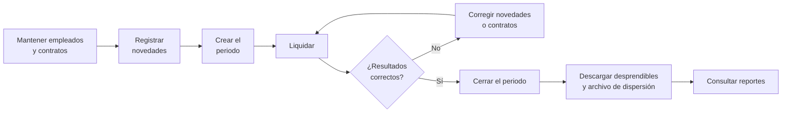

# 4. Manual de usuario

Este manual explica cómo operar Libra día a día. Está organizado según el ciclo real de una nómina.

## 4.1 Ingreso y navegación

1. Abra el navegador en `http://127.0.0.1:8000`.
2. Escriba su usuario y contraseña y pulse **Ingresar**.
3. La sesión dura 8 horas. Para salir, use **Salir** en la esquina superior derecha.

La pantalla tiene tres zonas:

| Zona | Contenido |
|---|---|
| Menú lateral (izquierda) | Módulos agrupados en *Operación*, *Personal*, *Análisis* y *Configuración*. La opción activa se marca con una barra cobre. |
| Barra superior | Fecha, usuario y rol. |
| Área de trabajo | Ruta de navegación, título de la página, botones de acción a la derecha y contenido. |

Los botones que modifican información solo aparecen si su rol lo permite.

## 4.2 Ciclo mensual de trabajo

## 4.3 Tablero

Es la página de inicio. Muestra:

- **Cifras clave**: empleados activos, novedades pendientes, neto pagado y costo total del último mes cerrado.
- **Costo de nómina por mes**: barras con devengado, aportes y provisiones de los últimos seis meses cerrados, con la tabla de valores debajo.
- **Periodos en curso**: periodos abiertos o liquidados pendientes de cierre.
- **Contratos a término fijo por vencer** en los próximos 60 días. La ley exige preavisar por escrito con 30 días de anticipación si el contrato no se va a prorrogar.
- **Distribución del costo por centro de costo**.

## 4.4 Personal

### Registrar un empleado

1. *Personal → Empleados → **Nuevo empleado***.
2. Complete los datos de identificación, contacto, cuenta bancaria y afiliaciones (EPS, fondo de pensiones, fondo de cesantías, caja).
   - Deje el **fondo de pensiones** vacío solo para pensionados; así no se descuenta ni se aporta pensión.
3. Pulse **Guardar**. El sistema lo lleva a la ficha del empleado.

### Crear el contrato

Desde la ficha del empleado pulse **Nuevo contrato** y diligencie:

| Campo | Indicaciones |
|---|---|
| Número | Se sugiere el consecutivo `CI-#####`. |
| Tipo de contrato | Indefinido, término fijo (exige fecha de finalización) u obra o labor. |
| Tipo de salario | *Ordinario* o *Integral* (mínimo 13 SMMLV). |
| Salario mensual | No puede ser inferior al SMMLV. |
| Periodicidad de pago | *Quincenal* o *Mensual*. Define en qué periodos se liquida el contrato. |
| Cargo y centro de costo | Clasifican el costo en los reportes. |
| ARL y clase de riesgo | Determinan la tarifa del aporte de riesgos laborales. |

Un empleado solo puede tener un contrato vigente a la vez. Para un cambio de salario o cargo, edite el contrato vigente: el cambio aplica desde la siguiente liquidación y no altera los periodos ya liquidados.

### Estructura organizacional

*Personal → Estructura organizacional* muestra centros de costo, áreas y cargos, con el número de contratos vigentes en cada uno. Solo el Administrador puede crearlos o editarlos.

## 4.5 Novedades

Una novedad es cualquier hecho del periodo que cambia el pago de un trabajador.

1. *Operación → Novedades → **Registrar novedad*** (o **Registrar novedad** desde la ficha del empleado).
2. Seleccione el empleado y el concepto. El formulario muestra solo los campos que aplican:

| Tipo | Ejemplos | Qué registrar |
|---|---|---|
| **Por horas** | Recargo nocturno, horas extra, dominicales | Fecha y número de horas. Registre un evento por día. |
| **Por días** | Incapacidades, licencias, vacaciones, suspensiones | Fecha inicial y final. Para **vacaciones**, además los días **hábiles** que se descuentan del saldo. |
| **Por valor** | Comisiones, bonificaciones, auxilios, descuentos | Fecha y valor. |

3. Pulse **Guardar novedad**. Queda en estado *Pendiente*.

**¿En qué periodo se paga?**

- Las novedades por horas y por valor se liquidan en el periodo que contiene su fecha, o en el siguiente abierto si se registraron tarde.
- Las novedades por días se reparten: cada periodo toma los días del rango que le corresponden. Una incapacidad del 10 al 19 de noviembre se paga 6 días en la primera quincena y 4 en la segunda.

Solo las novedades *Pendientes* se pueden editar o anular. Una novedad *Aplicada* ya hace parte de un periodo cerrado.

## 4.6 Préstamos y libranzas

1. *Operación → Préstamos y libranzas → **Registrar préstamo***.
2. Indique el empleado, el tipo (*Cuota préstamo empresa* o *Cuota libranza*), la descripción, la fecha de desembolso, el monto y el número de cuotas. Si deja vacío el valor de la cuota, se calcula como monto ÷ cuotas.
3. La cuota se descuenta en **cada periodo de pago del contrato** (cada quincena si es quincenal).

La barra de avance muestra la parte pagada. El saldo se actualiza al **cerrar** cada periodo. El Administrador puede **anular** un préstamo para detener los descuentos.

## 4.7 Periodos de nómina

### Crear el periodo

1. *Operación → Periodos de nómina → **Nuevo periodo***.
2. Elija periodicidad, año, mes y número (1 o 2 para quincenas) y la fecha de pago. Las fechas inicial y final se calculan solas.

### Liquidar

En la página del periodo pulse **Liquidar**. El sistema:

- incluye todos los contratos con esa periodicidad vigentes en algún día del periodo;
- toma las novedades pendientes y los préstamos activos;
- calcula devengados, deducciones, aportes y provisiones.

La página muestra entonces:

| Sección | Contenido |
|---|---|
| Pasos | Avance del ciclo: creado → liquidación → revisión y cierre → pago. |
| Cifras | Empleados, devengado, deducciones, **neto a pagar** y costo para la empresa. |
| Observaciones del cálculo | Situaciones que merecen revisión: cuotas ajustadas, ausencias cruzadas, incapacidades llevadas al mínimo, horas en salario integral. |
| Liquidación por empleado | Una fila por contrato. Clic en el nombre para ver el detalle. Entre paréntesis, los días pagados como salario cuando hubo ausencias. |
| Resumen por concepto | Totales agrupados por devengados, deducciones, aportes y provisiones. |

Si después de liquidar registra o corrige novedades, pulse **Reliquidar**. Un aviso amarillo indica si hay novedades pendientes que no quedaron incluidas.

### Detalle por empleado

Muestra cada concepto con su **cantidad**, **base**, **tasa o factor** y **valor**, agrupados en devengados, deducciones, aportes y provisiones. Desde aquí se descarga el **desprendible PDF**.

### Cerrar

Cuando los valores estén aprobados, el Administrador pulsa **Cerrar periodo**. Al cerrar:

- las novedades quedan *Aplicadas*;
- se descuentan las cuotas del saldo de los préstamos;
- el periodo queda en solo lectura.

Si se detecta un error después del cierre, el Administrador puede **Reabrir** el periodo (siempre que no haya un periodo posterior cerrado), corregir y volver a liquidar y cerrar.

### Documentos del periodo

| Botón | Archivo | Contenido |
|---|---|---|
| **Desprendibles PDF** | `desprendibles_AAAA-MM-Qn.pdf` | Un comprobante por página para todos los empleados. |
| **Sábana Excel** | `sabana_AAAA-MM-Qn.xlsx` | Hoja *Sábana*: un empleado por fila y un concepto por columna. Hoja *Resumen por concepto*. Hoja *Dispersión bancaria*: banco, tipo y número de cuenta y valor a consignar. |

## 4.8 Retiros y liquidaciones de contrato

1. *Operación → Retiros y liquidaciones → **Nueva liquidación*** (o **Liquidar retiro** desde el contrato en la ficha del empleado).
2. Seleccione el contrato, la fecha de retiro y la causa. Pulse **Calcular**.
3. Revise el detalle: base de liquidación, días, cesantías, intereses, prima, vacaciones pendientes e indemnización (si el despido es sin justa causa).
4. Pulse **Guardar como borrador**.
5. El Administrador revisa y pulsa **Aprobar y terminar contrato**. El contrato queda *Terminado* en la fecha de retiro y el empleado pasa a *Retirado* si no tiene otro contrato vigente.
6. Descargue el **Documento PDF** con espacio para las firmas.

> **Orden recomendado:** apruebe la liquidación de retiro **antes** de liquidar el periodo de nómina en que ocurre el retiro. Así ese periodo paga el salario solo hasta la fecha de retiro.

## 4.9 Reportes

*Análisis → Reportes*. Elija mes y año y pulse **Consultar**. Se consolidan los periodos quincenales y mensuales liquidados o cerrados del mes.

| Reporte | Uso |
|---|---|
| Costo por centro de costo | Distribución contable del gasto de personal. Exportable a Excel. |
| Aportes a seguridad social por entidad | Valores a pagar a cada EPS, fondo de pensiones, ARL y caja, separando la parte del empleado y la del empleador, más ICBF y SENA. |
| Provisiones del mes | Cesantías, intereses, prima y vacaciones a reconocer contablemente. |

## 4.10 Configuración

| Opción | Quién | Uso |
|---|---|---|
| Empresa | Administrador edita; todos consultan | Razón social, NIT, dirección y si aplica la exoneración de aportes. |
| Parámetros legales | Administrador | Registrar una **nueva vigencia** cada vez que cambie el SMMLV, el auxilio, la UVT, la jornada o un recargo. El formulario se precarga con los valores vigentes; solo cambie lo que corresponda. **No edite** una vigencia que ya se usó en periodos cerrados: cree una nueva. |
| Conceptos de nómina | Consulta | Catálogo de conceptos y a qué bases suma cada uno. |
| Entidades | Administrador | EPS, fondos, cajas, ARL y bancos. Inactive las que ya no use en lugar de borrarlas. |
| Usuarios | Administrador | Crear usuarios, asignar rol, cambiar contraseña y desactivar. |
| Auditoría | Administrador | Quién creó, editó, liquidó, cerró, reabrió o anuló qué y cuándo. |

## 4.11 Preguntas frecuentes

**Un empleado no aparece en la liquidación.** Verifique que su contrato esté vigente en las fechas del periodo y que la periodicidad del contrato coincida con la del periodo.

**El neto de un empleado es cero.** Las deducciones (por ejemplo, la cuota de un préstamo) consumieron todo el devengado. Revise las observaciones del cálculo; la cuota se ajustó para no dejar el neto en negativo.

**Registré una novedad y no se reflejó.** Si el periodo ya estaba liquidado, pulse **Reliquidar**. Si ya estaba cerrado, la novedad se liquidará en el siguiente periodo abierto.

**Cambió el salario mínimo.** El Administrador debe crear una nueva vigencia en *Parámetros legales* con fecha 1 de enero. Los contratos con salario mínimo deben actualizarse uno a uno en su contrato.

**¿Por qué los intereses de cesantías provisionados son tan bajos?** Son el 12 % anual **sobre las cesantías**, no sobre el salario: aproximadamente el 1 % de la base mensual.
