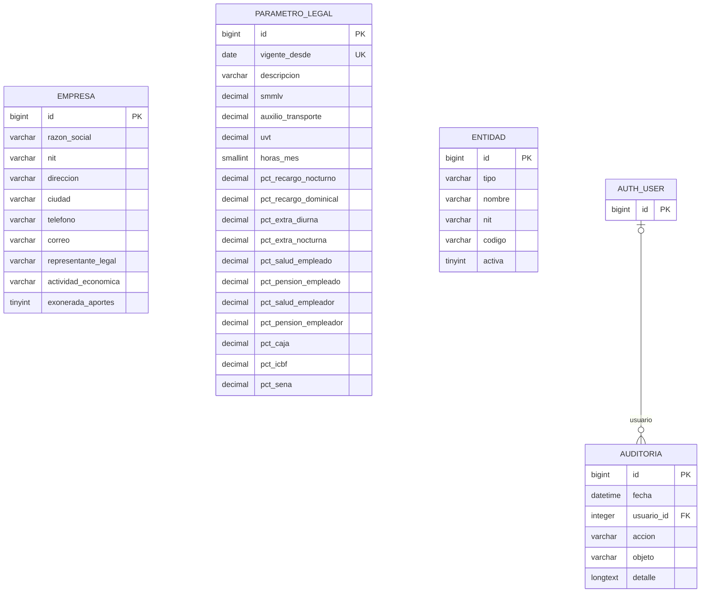
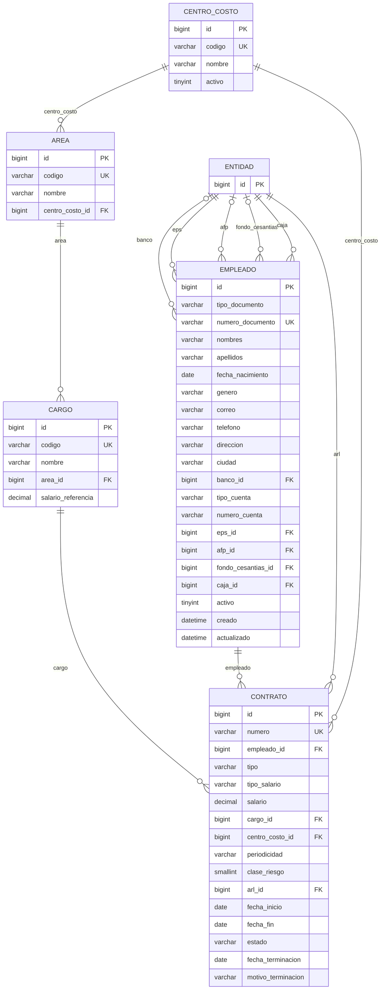
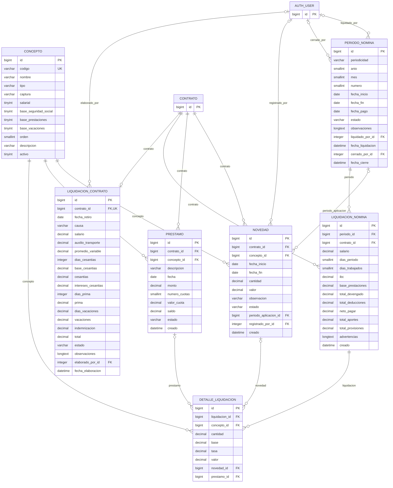
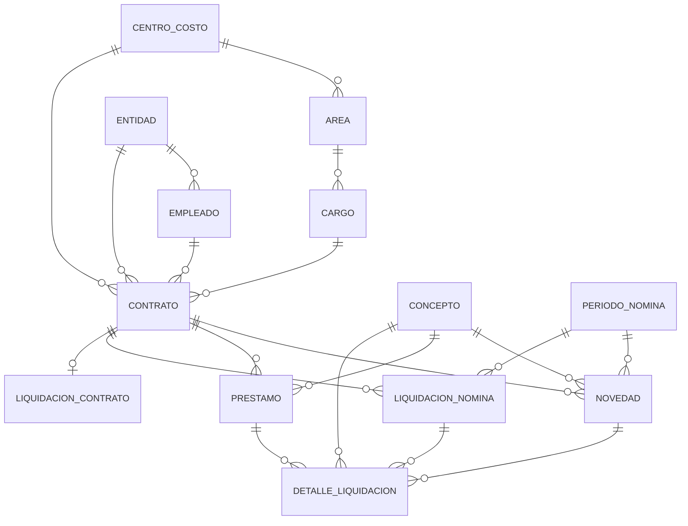

# Diagrama entidad-relación

> Archivo generado con `python manage.py documentar_bd`. No lo edite a mano.

Notación: `PK` llave primaria, `FK` llave foránea, `UK` valor único. 
Las relaciones usan la notación *pata de gallo*: `||--o{` significa *uno a muchos*, 
`||--o|` *uno a cero o uno*.

## Módulo Configuración general

## Módulo Personal

## Módulo Nómina

## Vista general de relaciones

